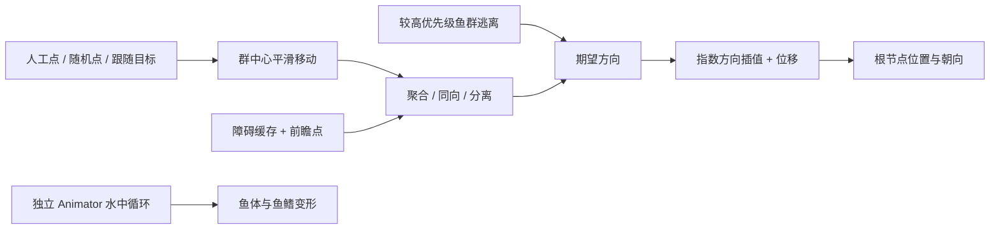

# 《欢乐钓鱼大师》水族箱鱼群运动还原

2026-11-02，来源 `fishing-master-xiaomi-20260814`。已还原 FishFlock 的核心群游求解、转向积分和点预测避障，整理巡游目标、碰撞缓存和引擎写回流程。**核心求解已与原始 ARM64 指令执行对照通过；没有启动 Android 游戏，不代表已复现线上水族箱的完整效果。**《钓鱼发烧友》尚未取得 APK，本报告不包含其算法。

权威状态为 [reconstruction-report.json](reconstruction-report.json)；输入、函数地址和逐函数哈希见 [native-evidence.json](native-evidence.json)。原始 APK 与本库 cnformal1 模型快照是不同来源，不能混称同一运行版本。

## 证据和还原深度

| 层次 | 结果 | 证据强度 |
|---|---|---|
| 模块、字段、方法地址 | 定位 15 个类型、70 个方法；保留相关机器码和常量 | 元数据与 ELF 地址对应；不表示 70 个方法均逐项执行验证 |
| 分离、逃离、转向/积分窗口 | 330 组原生指令对照通过 | 执行原始 ARM64，包含重叠点和反向转弯负例 |
| 整段 `ComputeFlockBehaviours` | 65 组多鱼、多组、优先级、箱/球障碍、XYZ/XY/XZ 场景通过 | 执行原始 ARM64 主循环；替代 List 数据访问和 `expf`，保留原生 Flee |
| 巡游路径、群中心、碰撞缓存、Transform 写回 | 已跟踪原生控制流并整理 | 静态反汇编，未在 Unity 场景中执行 |
| Lua 业务编排、服务器逐鱼参数、惊鱼触发、骨骼与速度联动 | 保留接口与未知，未声称完整还原 | 原始 AquariumController 为改版 LuaJIT 字节码，常规反编译未成功 |

395 组比较均通过。65 组整步对照的最大绝对分量误差约 `1.78e-7`；各例实值在 [steering-validation-report.json](steering-validation-report.json)，独立内核在 [kernel-validation-report.json](kernel-validation-report.json)。这些是合成输入对照，既不是游戏实机测试，也不是大规模鱼数或帧率测试。

[reference_model.py](reference_model.py) 是可读的核心公式还原，特意保留原实现的顺序依赖与缺陷，供研究对照。**不能直接作为我们生产求解器。** [FishFlock.type-map.cs](FishFlock.type-map.cs) 仅是类型、字段偏移及方法签名；其中空方法体是工具占位，不是反编译出的 C# 实现。逐指令证据为 [fish-flock.arm64.asm](fish-flock.arm64.asm)。

## 一帧怎样移动



普通 Update 顺序为：取得 `deltaTime` → 条件刷新碰撞缓存 → 更新各组群中心 → CPU 模式执行群游求解 → 各组写回 Transform。`CPU_AND_ONE_THREAD` 初始化会注册同一求解回调；线程同步和真实启用配置尚未验证。枚举含 GPU，但已追踪 Update/Initialize 路径没有 GPU 求解分支，不能据此宣称 GPU 鱼群已启用。

### 1. 群中心带队巡游

`GeneratePath` (`0x207ac48`) 优先取外部 Transform 目标点列表，其次人工预置点，否则在控制器中心的轴对齐长方体范围内随机生成目标点。没有证据表明这里使用样条或 NavMesh。

`UpdateGroupAnchor` (`0x207aebc`)：跟随模式读取目标实时位置；普通模式朝当前路径点移动，距离小于 1 个世界单位则推进索引。末端可以重生成、循环或停在末点。平滑式为：

```text
anchor += (target - anchor) * deltaTime * groupAreaSpeed
```

系数没有 Clamp01，大步长可能越过目标。`isInsideBox` 只约束群中心在水域内，并不证明每条鱼、整条身体及鳍都不越界。鱼不是沿固定轨道排队，而是跟随这个移动的群中心，同时受邻鱼影响。

### 2. 聚群、同向与分离

`ComputeFlockBehaviours` (`0x207dfa8`) 逐组、逐鱼处理，**原地立即写回**；后面的鱼会读到前面鱼本帧已更新的位置/方向，列表顺序会影响结果。

对于一条受群控制的鱼，群中心先作为一个虚拟邻居：位置和为 anchor，方向和为零，计数从 1 开始。同优先级组的鱼均可成为邻居，感知半径取两组半径的较大值。这段原生函数按优先级关联群组，未按物种过滤；实际物种/组的分配由上层决定。

```text
diff = ownPosition - otherPosition
distance = length(diff)
if distance < radius:
    positionSum += otherPosition
    directionSum += otherDirection
    separation += diff / distance * Clamp01(1 - distance / radius)
    count += 1

steer = Normalize(positionSum / count - ownPosition)
      + directionSum / count
      + separation
      + obstacleAvoidance
```

没有在这段公式中发现独立可调的三项权重。邻居满足 `count > 9` 时只退出**当前组**内循环，其他组仍继续；它不是全局 9 邻居上限，也没有空间索引或候选访问上限。分离的零距离除法会得到 NaN（原生内核已验证），不能照搬。

配置半径与内部平滑半径分开；初始化内部半径为 `1e-5`，再随 `smoothDeltaTime`/smoothRate 向配置值靠近。不能把这一过渡当作鱼体间距保证。

### 3. 避障是前瞻点命中后的排斥

```text
ahead = position + direction * speed * deltaTime * lookAheadSteps
avoid = 0
for cachedCollider in order:
    if ahead inside collider:
        avoid = Normalize(avoid + ahead - colliderCenter) * force
```

这是每次命中后重新归一化的累积，结果依赖障碍顺序。前瞻长度依赖本帧时长；没有线段扫描、鱼体半径、完整鳍范围或连续碰撞检测，可能穿越薄障碍，前瞻点恰在中心时也缺少明确脱困方向。

`UpdateCollisionData` (`0x207d33c`) 将 BoxCollider 转为轴对齐 min/size：中心为 `transform.position + collider.center`，尺寸为 `localScale * collider.size + offset`；该计算未处理旋转的盒体/中心变换。SphereCollider 使用 Transform 位置和 `localScale.x * radius`，没有使用 SphereCollider.center，也不能正确表达非均匀或父级缩放。仅这两类有对应转换；不等于支持任意模型碰撞。运行时刷新构造默认间隔约 0.3 秒，真实场景可覆盖。

### 4. 逃离与一个实际实现缺陷

当前组避让更高优先级组；进入对方 `fleeRadius` 后，每条威胁鱼贡献：

```text
flee += Normalize(ownPosition - threatPosition) * ownSpeed - ownDirection
```

高优先级组索引列表在**每组开始**清空，随后每条鱼都会再次追加相同组索引，产生重复计算。2 条当前组鱼面对 2 条高优先级鱼时共调用 6 次 Flee；3 对 3 为 18 次，4 对 4 为 40 次，均已在原生完整函数中计数验证。这是应避免的实现缺陷，不能解释成生物行为设计。

### 5. 转向与位移

设 `desired = Normalize(steer + flee)`，`current = Normalize(oldDirection)`：

```text
factor = min(1, exp(-rot_speed * deltaTime))
direction = desired + factor * (current - desired)
position += direction * speed * deltaTime
```

`rot_speed` 是指数响应系数，不是“度/秒”。插值后的 direction 没有再次归一化，所以弯急时会自然减速；旧方向与目标完全反向、factor=0.5 时方向归零，本步停止平移，原生指令已验证。没有显式最大角速度和加速度限制。XYZ/XY/XZ 模式还会施加平面约束；具体先后顺序见可执行还原，不能把它简单替换成最终统一投影。

`FishGroup.OnUpdate` (`0x207b9ac`) 写根节点位置并按方向 LookRotation，方向平方长度过小则跳过转向；外部控制的鱼会反向同步 Transform 位置/forward 至数据。此模块未见逐骨骼驱动。`idle_aquarium` 的循环骨骼动作来自另外的 Animator；身体弯曲、摆尾是否随真实转弯/速度联动仍未知，不能把根朝向变化当作已还原自然转弯动作。

## 构造默认值，不能当作线上逐鱼参数

| 参数 | 构造默认 |
|---|---|
| 群速度范围 | 2.58–6.58 |
| 转向指数系数范围 | 1.88–6.14 |
| 出生半径 / 逃离半径 / 邻距 | 2 / 1 / 4 |
| 群中心响应 / 初始平滑率 | 0.8 / 10 |
| 随机路径点数量参数 | Int2(2,5)，最终整数范围遵循所调用 Unity Random.Range |
| 水域宽、高、深 | 25、20、25 |
| 前瞻帧步数 / 避障强度 | 3 / 20 |

这些是世界单位及代码默认，不是 cm、生物游速或当前每种鱼实际值。Lua 可设置 speedMin/speedMax、rotationSpeedMin/rotationspeedMax、swimmingArea 等，但其当前实际配置未恢复。CreateBehaviour/AddFish 初始化方向还涉及 Quaternion 插值后读取 EulerAngles；未执行完整引擎初始化顺序，不应直接抄初始化语义。

## 与我们现有实验比较

对照时读取的文件和 SHA256 保存在 [our-code-inputs.json](our-code-inputs.json)，代表本轮读取时版本，不授予生产或视觉验收。现有 `FishSchoolSimulation.gd` 自身标记为实验 CPU 工作负载；分档是固定决策频次，不是可见性或距离 LOD。

| 项目 | 对方实现 | 我们现有实验与建议 |
|---|---|---|
| 大方向巡游 | 移动群中心，支持人工/随机/跟随点 | 值得在我们的路线层增加“软群中心”，控制水层与区域分布；仍保留障碍绕行路线 |
| 参数分层 | 控制器、组、逐鱼速度/转向 | 值得参考，独立定义物种、群组与个体变化，避免全缸同步；数值需重新调，不照抄默认 |
| 社交关系 | 同优先级混合，较高优先级触发逃离 | 将“是否同群”与“谁避让谁”分开；不要让物种身份与威胁优先级绑定 |
| 邻居查找 | 全表扫描，组内提前退出、顺序偏差 | 保留我们的空间网格、96 候选访问与24邻居双上限、轮换遍历及零距离兜底 |
| 转向与步长 | deltaTime，指数方向线性混合 | 可参考缓慢趋向目标的观感；保留我们的固定步长、加速度/角速度约束和180°兜底，避免停摆 |
| 障碍表示 | 箱/球缓存，前瞻点检测 | 可参考缓存与数据/Transform分离；摆件变化采用显式脏标记。我们已有路线绕行及反应避让，不能退回点检测 |
| 体型余量 | 未见整鱼体积参与上述避障 | 我们当前0.18固定球半径也只是实验代理。自由造景需鱼种实际身体/鳍包络、旋转摆件与扫掠验证 |
| 体态与运动 | 根节点跟随；骨骼动作另行播放 | 保留现有 MotionAdapter 的方向历史、延迟弯体与原摆尾/鳍相位；对方未证实更完整的耦合 |
| 外部接管 | 非群控对象反向同步状态 | 值得借鉴点击、投喂、惊鱼或展示后回群时的状态交接；触发机制由我们自行设计验证 |

当前建议的改进顺序：先在现有实验路线层试验软群中心与区域偏好，再做物种/群组/个体参数；随后以真实造景和鱼体包络验证避障及转弯。此处只是有证据的适配建议，**本轮没有改动 `projects/fishing-2d` 实现或生产鱼资产**，没有跑规模基准，也没有推导数百条鱼的可用帧率。

## 复核与来源

从仓库根目录运行：

```bash
python3 resources/fish-database/evidence/fishing-master-xiaomi-20260814/motion-reconstruction/prepare_native_input.py
uv pip install --python /path/to/python --target work/fish-motion-reconstruction-20261102/deps unicorn==2.1.4 pyelftools==0.33
PYTHONDONTWRITEBYTECODE=1 /path/to/python resources/fish-database/evidence/fishing-master-xiaomi-20260814/motion-reconstruction/verify_full_step.py
```

先选择与 Python 匹配的安装方式；上例 `/path/to/python` 是占位，脚本本轮用系统 `python3` 执行。完整性复核可运行同目录的 `validate_reconstruction.py`。报告写入仓库 `work/fish-motion-reconstruction-20261102/`；核对后将必要结果归档并清理该目录。准备脚本只从已保留 APK 提取两个原始输入、核验 SHA，不启动游戏。完整指令地址绑定本版二进制，其他版本须重新定位。

工具版本、官方来源、成功与失败方法见 [tool-provenance.json](tool-provenance.json)。原始代码切片 20,420 字节、常量切片 52 字节交由 LFS，文本/报告/还原与验证脚本保留普通 Git；完整 .so/元数据已在 APK 中，不保留展开副本。本库现有来源许可记录继续适用，不由此次算法调查改变生产素材使用授权。
